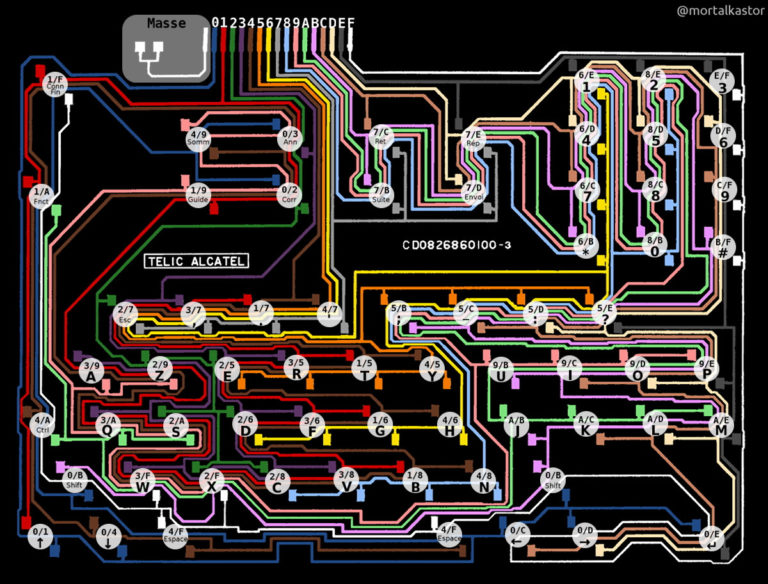
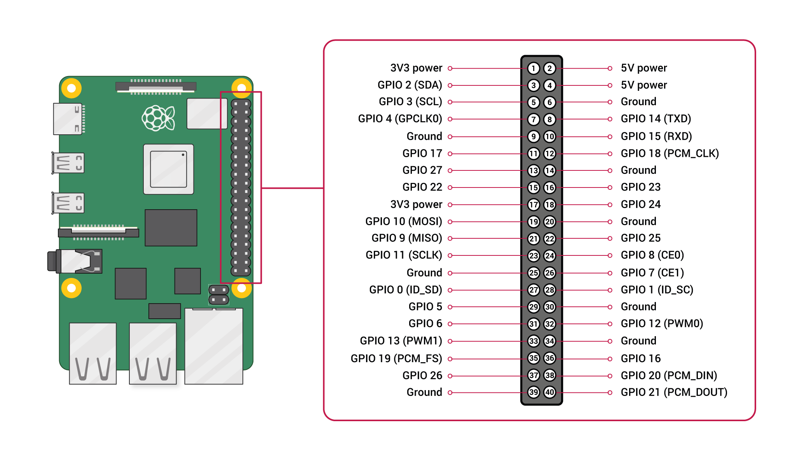

# Minitel Keyboard GPIO Interface

A Python script to interface a Minitel's matrix keyboard with a Raspberry Pi using GPIO.

## Overview

This project allows you to connect a **Minitel 1 matrix keyboard** (tested on a Matra model) to a **Raspberry Pi** via GPIO. The script uses an adapter to link the GPIO pins to the keyboard's ribbon cable, enabling the Raspberry Pi to detect and interpret key presses.

The keyboard is **matrix-based**, meaning it is scanned by sending current through specific rows and reading the output on columns to determine which keys are pressed.

## Features

- **GPIO Integration**: Uses Raspberry Pi's GPIO to interface with the Minitel keyboard.
- **Dynamic Key Mapping**: Automatically detects unknown keys and prompts the user to map them using `evdev` keycodes.
- **Configuration File**: Stores discovered key mappings in `keyboard.conf` for future use.
- **Compatibility**: Designed to work with most Raspberry Pi models.

## Files

| File | Description |
|------|-------------|
| `keyboard.py` | Main script to interface with the Minitel keyboard. |
| `keyboard.conf` | Configuration file containing discovered key mappings. |

## Requirements

- **Raspberry Pi** (any model with GPIO)
- **Python 3.x**
- **evdev** library (`pip install evdev`)
- **RPi.GPIO** library (`pip install RPi.GPIO`)
- **Adapter** to connect the Minitel keyboard ribbon to GPIO pins (You will have to build yours)

## Cablage




Clavier Minitel 1B → Raspberry Pi 3B

8 lignes

| Minitel | Raspberry Pi |
| ------- | ------------ |
| 2       | 29 (GPIO 5)  |
| 3       | 31 (GPIO 6)  |
| 4       | 32 (GPIO 12) |
| 5       | 33 (GPIO 13) |
| C       | 36 (GPIO 16) |
| D       | 35 (GPIO 19) |
| E       | 38 (GPIO 20) |
| F       | 40 (GPIO 21) |

8 colonnes

| Minitel | Raspberry Pi |
| ------- | ------------ |
| 1       | 7 (GPIO 4)   |
| 6       | 11 (GPIO 17) |
| 7       | 12 (GPIO 18) |
| 8       | 15 (GPIO 22) |
| 9       | 16 (GPIO 23) |
| A       | 18 (GPIO 24) |
| B       | 22 (GPIO 25) |
| G       | 13 (GPIO 27) |

Le premier numéro correspond à la broche physique du connecteur 40 broches. Le numéro entre parenthèses correspond au GPIO BCM utilisé dans le programme.

## Installation

1. Clone this repository or download the files.
2. Install the required Python libraries:
   ```bash
   pip install evdev RPi.GPIO
   ```
3. Connect the Minitel keyboard to the Raspberry Pi using your adapter.
4. Run the script:
   ```bash
   python3 keyboard.py
   ```

## Usage

1. The script will scan the keyboard matrix and detect key presses.
2. If an unknown key is pressed, the script will prompt you to enter the corresponding `evdev` keycode.
3. The new mapping will be saved to `keyboard.conf`.

## License

This project is licensed under the **GNU General Public License**.

## Contributing

Contributions are welcome! If you have suggestions, feel free to submit a pull request.
